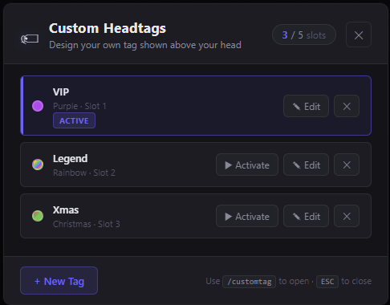
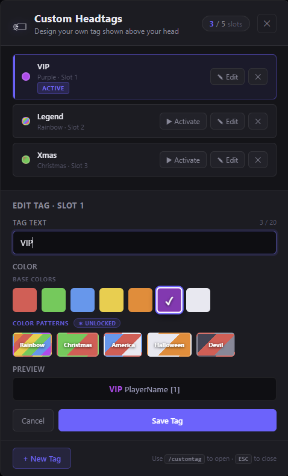

# DiscordTagIDs

> Display Discord role-based headtags above players in GTA V (FiveM), with color patterns, custom player-created tags, and a full in-game UI.

[](https://discord.com/invite/WjB5VFz)

📄 **Extended documentation:** https://docs.badger.store/fivem-discord-scripts/discordtagids

---

## Credits

- **MrDaGree** — original player name tag script this was adapted from ([forum post](https://forum.fivem.net/t/release-changed-player-name-tags-distance-names/19204))
- **BadgerTools-Revamped** — color pattern cycling system

---

## Requirements

| Dependency | Purpose |
|---|---|
| [Badger_Discord_API](https://forum.fivem.net/t/discord-roles-for-permissions-im-creative-i-know/233805) | Required — fetches Discord roles |
| [oxmysql](https://github.com/overextended/oxmysql) | Optional — only needed if `CustomTags.Storage = "database"` |

---

## Features

### Role-Based Headtags
Tags are driven entirely by Discord roles. Each role maps to a tag string using GTA color codes. Players with multiple matching roles can switch between their available tags using `/headtag`.

### Color Patterns
Tags can cycle through multiple colors over time. The following pattern tokens are built in and can be used in any tag string:

| Token | Colors |
|---|---|
| `~RGB~` | Cycles through all 7 base colors |
| `~CHRISTMAS~` | Red → Green |
| `~AMERICA~` | Red → White → Blue |
| `~HALLOWEEN~` | Orange → White |
| `~DEVIL~` | Red → Grey → Dark Grey |

You can define your own patterns in `Config.ColorPatterns`. The speed of cycling is controlled by `Config.ColorChangeSpeed` (milliseconds, default `500`).

```lua
-- Example: add a custom pattern token
ColorPatterns = {
    ['~SUNSET~'] = {'~r~', '~o~', '~y~'},
}

-- Then use it in a role tag:
roleList = {
    {123456789, "~SUNSET~Admin ~w~"},
}
```

### HUD Display
A small on-screen HUD shows the player's currently active headtag. Position, scale, and format are all configurable.

### Custom Player Headtags *(optional feature)*
Players can create their own headtags through an in-game UI panel (`/customtag`). Slot counts and unlocked color patterns are gated behind FiveM ACE permissions or Discord role IDs — see [Configuration](#configuration) below.

---

## Commands

| Command | Who | Description |
|---|---|---|
| `/headtag` | Any player | List your available role tags and switch between them |
| `/headtag <id>` | Any player | Switch to a specific role tag by number |
| `/tag-toggle` | Any player | Hide/show your own prefix in your headtag |
| `/tags-toggle` | Any / Staff | Hide all headtags above other players (useful for streaming) |
| `/customtag` | Players with slots | Open the custom headtag UI panel |

> `/tags-toggle` can be restricted to staff only by setting `TagsForStaffOnly = true` and granting the ACE permission `DiscordTagIDs.Use.Tag-Toggle`.

---

## Installation

1. Download or clone this repository
2. Place the `DiscordTagIDs` folder inside your server's `/resources/` directory
3. Add `ensure DiscordTagIDs` to your `server.cfg`
4. Make sure `Badger_Discord_API` is installed and running **before** this resource starts
5. Edit `config.lua` to match your Discord role IDs and preferences

---

## Configuration

All settings live in `config.lua`. Below is a full reference.

### General

```lua
Config = {
    Prefix              = '^9[^1Badger-Tags^9] ^3', -- Chat message prefix
    TagsForStaffOnly    = false,    -- Restrict /tags-toggle to ACE perm holders
    ShowOwnTag          = true,     -- Show your own tag above yourself
    UseDiscordName      = true,     -- Use Discord username instead of game name
    ShowDiscordDescrim  = false,    -- Show #discriminator (e.g. Badger#0002)
    RequiresLineOfSight = true,     -- Only show tags for players you can see
    FormatDisplayName   = "{PLAYER_NAME} [{SERVER_ID}]",
}
```

### Keybind

```lua
    UseKeyBind             = true,  -- Gate tag visibility behind a keybind
    UseKeyBindToggle       = true,  -- true = toggle on press, false = hold to show
    KeyBindToggleDefaultShow = true,-- Tags visible by default when toggled on
    KeyBind                = 10,    -- Page Up  (see fivem.net/docs/game-references/controls/)
```

### Role List

The first entry (`0` role ID) is the **default tag** applied to every player. Subsequent entries map a Discord role ID (or a named ace group string) to a tag string.

```lua
    roleList = {
        {0,                   "~g~Member ~w~"},
        {597449475547463681,  "~b~Developer ~w~"},
        {597450498060058624,  "~r~STAFF ~w~"},
        {"Founder",           "~RGB~FOUNDER ~w~"},  -- ace group name
    },
```

Players with multiple matching roles can cycle between them with `/headtag`.

### Color Patterns

```lua
    ColorChangeSpeed = 500, -- ms between color steps (lower = faster)

    ColorPatterns = {
        ['~RGB~']       = {'~g~', '~b~', '~y~', '~o~', '~r~', '~p~', '~w~'},
        ['~CHRISTMAS~'] = {'~r~', '~g~'},
        ['~AMERICA~']   = {'~r~', '~w~', '~b~'},
        ['~HALLOWEEN~'] = {'~o~', '~w~'},
        ['~DEVIL~']     = {'~r~', '~c~', '~m~'},
        -- Add your own tokens here
    },
```

### HUD

```lua
    HUD = {
        Display = true,
        Format  = '~p~Active Headtag: {HEADTAG}',
        x       = .75,
        y       = .50,
        Scale   = .55,
    },
```

### Custom Player Headtags

```lua
    CustomTags = {
        Enabled       = false,        -- Master toggle for the feature
        Storage       = "flatfile",   -- "flatfile" or "database" (requires oxmysql)
        MaxTextLength = 20,           -- Max characters in a custom tag label

        BadWordFilter = {
            Enabled = false,
            Words   = {"example_bad_word"},
        },

        -- Each entry grants a slot count and a list of unlocked pattern tokens.
        -- Players get the HIGHEST matching slot count.
        -- Players get the UNION of all matching pattern lists.
        -- Base solid colors (~r~ ~g~ ~b~ ~y~ ~o~ ~p~ ~w~) are always available.
        SlotPermissions = {
            {type = "ace",     perm   = "DiscordTagIDs.CustomTags.5", slots = 5,
             patterns = {"~RGB~", "~CHRISTMAS~", "~AMERICA~", "~HALLOWEEN~", "~DEVIL~"}},

            {type = "ace",     perm   = "DiscordTagIDs.CustomTags.3", slots = 3,
             patterns = {"~RGB~"}},

            {type = "ace",     perm   = "DiscordTagIDs.CustomTags.1", slots = 1,
             patterns = {}},

            -- Discord role variant:
            -- {type = "discord", roleId = 123456789012345678, slots = 3,
            --  patterns = {"~RGB~", "~CHRISTMAS~"}},
        },
    },
```

To grant a player 5 custom tag slots with all patterns, add this to your `server.cfg` or ACE perms file:

```
add_ace identifier.discord:THEIR_DISCORD_ID DiscordTagIDs.CustomTags.5 allow
```

---

## Custom Headtags UI

When `CustomTags.Enabled = true`, players can open the tag builder with `/customtag`.

The panel lets them:
- **Create** up to their permitted number of custom tags
- **Pick a color** from 7 base solid colors, plus any unlocked color patterns
- **Preview** their tag live (colors and patterns animate in real time)
- **Edit** or **delete** any existing tag
- **Activate** a tag to make it appear above their head immediately

A browser-based preview of the UI is included as `mockup.html` at the root of the resource — open it directly in any browser, no server required.

### Screenshots

**In-game headtags above players**


**`/tag-toggle` — hiding your own prefix**

| Prefix visible | Prefix hidden |
|---|---|
|  |  |

**`/tags-toggle` — hiding all tags above other players**

| Tags visible | Tags hidden |
|---|---|
|  |  |

**Custom Headtags UI**

**Tag list — with active tag and multiple slots used**



**Edit form — color picker, pattern swatches, and live preview**



---

## GTA Color Code Reference

| Code | Color |
|---|---|
| `~r~` | Red |
| `~g~` | Green |
| `~b~` | Blue |
| `~y~` | Yellow |
| `~o~` | Orange |
| `~p~` | Purple |
| `~w~` | White |
| `~c~` | Grey |
| `~m~` | Dark Grey |
| `~u~` | Black |
| `~n~` | New line |
| `~s~` | Reset color |
| `~h~` | Bold text |

---

## Other Resources

- [DiscordChatRoles](https://forum.fivem.net/t/discordchatroles-release/566338)
- [DiscordAcePerms](https://forum.fivem.net/t/discordaceperms-release/573044)
- [SandyVehiclesRestrict](https://github.com/TheWolfBadger/SandyVehiclesRestrict)
